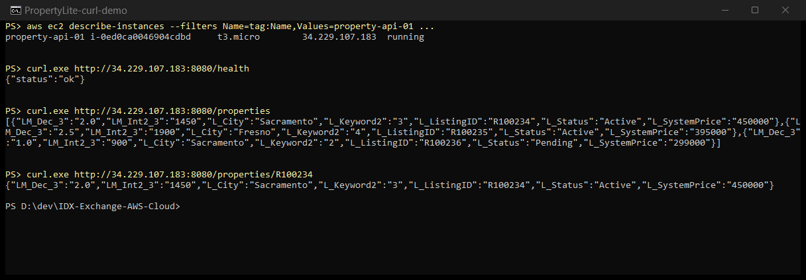

# Week 3 — Compute: EC2 Runbook

Deploying PropertyLite to a single EC2 instance with a bootstrap script, taking an EBS snapshot, and tearing everything down. I did every step with the AWS CLI from my laptop (Windows, Git Bash), with the console equivalent noted where it helps.

Region: `us-east-1`, default VPC, `minh-admin` profile.

## Lab 3.1 — Deploy PropertyLite to EC2

### 1. Pick the AMI

I used the latest Amazon Linux 2023 AMI. AWS publishes its ID as a public SSM parameter, so I don't have to copy it from the console:

```bash
MSYS_NO_PATHCONV=1 aws ssm get-parameter \
  --name /aws/service/ami-amazon-linux-latest/al2023-ami-kernel-default-x86_64 \
  --query "Parameter.Value" --output text
# ami-0d27e0fb3bac4d724
```

`MSYS_NO_PATHCONV=1` is a Git Bash quirk: without it, Git Bash rewrites `/aws/service/...` into a Windows path and the lookup fails with `ParameterNotFound`.

### 2. Create the key pair

Console: EC2 → Key pairs → Create key pair → `training-key`, RSA, `.pem`.

```bash
aws ec2 create-key-pair --key-name training-key --key-type rsa --key-format pem \
  --query KeyMaterial --output text > ~/.ssh/training-key.pem
chmod 400 ~/.ssh/training-key.pem
```

AWS only shows the private key once. If the `.pem` file is lost, the only fix is a new key pair. `chmod 400` makes the file read-only for me, otherwise SSH refuses it with "permissions too open". `*.pem` is in `.gitignore` so it can never be committed.

### 3. Create the security group

Console: Network settings → Create security group.

```bash
SG=$(aws ec2 create-security-group --group-name property-api-sg \
  --description "PropertyLite: SSH from my IP, 8080 from anywhere" \
  --vpc-id vpc-0ff18be76c414f1d4 --query GroupId --output text)

aws ec2 authorize-security-group-ingress --group-id $SG --ip-permissions \
  "IpProtocol=tcp,FromPort=22,ToPort=22,IpRanges=[{CidrIp=<my-ip>/32}]" \
  "IpProtocol=tcp,FromPort=8080,ToPort=8080,IpRanges=[{CidrIp=0.0.0.0/0}]"
```

| Port | Source | Why |
|---|---|---|
| 22 (SSH) | my public IP `/32` only | Only I should be able to log in. "Anywhere" on SSH invites brute-force attempts. |
| 8080 | `0.0.0.0/0` | PropertyLite listens on 8080 (not 80), and the API is meant to be reachable from anywhere. |

I got my public IP from `curl https://checkip.amazonaws.com`. Security groups are stateful, so the response traffic is allowed back out automatically.

### 4. Write the user data script

This script runs once as root on first boot. It updates the OS, installs Python and Flask, writes `app.py` and `rets_property_sample.csv` to `/opt/property-api`, and starts the app in the background with logs in `/var/log/property-api.log`. I built it from the files in `propertylite/` so the instance runs exactly the code I tested locally in Week 0, with no changes. I saved it locally as `user-data.sh` to pass it to the CLI.

The training PDF's copy of this script lost some characters in formatting (`__name__` became `name`, and the `<listing_id>` route parameter disappeared), so I used the real files instead of copying from the PDF.

```bash
#!/bin/bash
yum update -y
yum install -y python3 python3-pip
pip3 install flask==3.0.3
mkdir -p /opt/property-api
cat > /opt/property-api/app.py << 'PYEOF'
import csv, os
from flask import Flask, jsonify, request

app = Flask(__name__)

DATA_PATH = os.environ.get("PROPERTY_DATA_PATH", "rets_property_sample.csv")

def load_properties():
    with open(DATA_PATH, newline="") as f:
        return list(csv.DictReader(f))

@app.route("/health")
def health():
    return jsonify(status="ok")

@app.route("/properties")
def list_properties():
    city = request.args.get("city")
    rows = load_properties()

    if city:
        rows = [
            r for r in rows
            if r.get("L_City", "").lower() == city.lower()
        ]

    return jsonify(rows[:50])

@app.route("/properties/<listing_id>")
def get_property(listing_id):
    rows = load_properties()

    match = next(
        (
            r for r in rows
            if r.get("L_ListingID") == listing_id
        ),
        None
    )

    if not match:
        return jsonify(error="not found"), 404

    return jsonify(match)

if __name__ == "__main__":
    app.run(host="0.0.0.0", port=8080)
PYEOF
cat > /opt/property-api/rets_property_sample.csv << 'CSVEOF'
L_ListingID,L_City,L_Keyword2,LM_Dec_3,LM_Int2_3,L_SystemPrice,L_Status
R100234,Sacramento,3,2.0,1450,450000,Active
R100235,Fresno,4,2.5,1900,395000,Active
R100236,Sacramento,2,1.0,900,299000,Pending
CSVEOF
cd /opt/property-api && nohup python3 app.py > /var/log/property-api.log 2>&1 &
```

### 5. Launch the instance

Console: EC2 → Launch instance → name `property-api-01`, Amazon Linux 2023, `t3.micro`, key pair `training-key`, the security group above, user data pasted under Advanced details.

```bash
aws ec2 run-instances --image-id ami-0d27e0fb3bac4d724 --instance-type t3.micro \
  --key-name training-key --security-group-ids $SG \
  --user-data file://user-data.sh \
  --tag-specifications "ResourceType=instance,Tags=[{Key=Name,Value=property-api-01}]"

aws ec2 wait instance-running --instance-ids <instance-id>
aws ec2 describe-instances --instance-ids <instance-id> \
  --query "Reservations[0].Instances[0].PublicIpAddress" --output text
```

"Running" only means the VM booted. The user data script still needs a couple of minutes (`yum update` is the slow part) before the app answers, so I retried the health check until it responded:

```bash
curl -s -m 5 --retry 40 --retry-delay 10 --retry-all-errors http://<public-ip>:8080/health
```

### 6. Verify

```bash
curl http://<public-ip>:8080/health              # {"status":"ok"}
curl http://<public-ip>:8080/properties          # all 3 sample listings
curl http://<public-ip>:8080/properties/R100234  # the Sacramento listing
curl http://<public-ip>:8080/properties/NOPE     # {"error":"not found"}, HTTP 404
```



It worked: `/health` returned `{"status":"ok"}` and `/properties/R100234` returned the Sacramento listing. That is the same app I ran locally in Week 0, now running on a real server.

### 7. SSH in

```bash
ssh -i ~/.ssh/training-key.pem ec2-user@<public-ip>
```

Inside the instance I confirmed the OS (`Amazon Linux 2023`), that `python3 app.py` was running, and that `/var/log/property-api.log` showed my curl requests coming from my IP.

## Lab 3.2 — EBS snapshot

Console: EC2 → Volumes → select the root volume → Actions → Create snapshot.

```bash
VOL=$(aws ec2 describe-instances --instance-ids <instance-id> \
  --query "Reservations[0].Instances[0].BlockDeviceMappings[0].Ebs.VolumeId" --output text)
SNAP=$(aws ec2 create-snapshot --volume-id $VOL \
  --description "property-api-01 root volume" --query SnapshotId --output text)
aws ec2 wait snapshot-completed --snapshot-ids $SNAP
```

The root volume was an 8 GiB gp3 volume, and the snapshot reached `completed` in under a minute.

**If I created a new volume from this snapshot,** I would get an exact copy of the root disk as it was when the snapshot was taken: Amazon Linux, Flask, and PropertyLite already installed in `/opt/property-api`. I could attach it to another instance in any AZ of the region, or turn it into an AMI to launch pre-built servers without running the user data again.

## Debug Lab 3.3 — SSH connection times out

If SSH suddenly hangs and times out, check these in order:

1. Is the instance actually `running`? (`aws ec2 describe-instances`)
2. Has my public IP changed? Compare `curl https://checkip.amazonaws.com` with the SSH rule's source in the security group.
3. Does the VPC have an internet gateway, and does the subnet's route table send `0.0.0.0/0` to it?

The usual cause is #2. "My IP" is a snapshot of my address when I created the rule, not a live lookup. On home Wi-Fi, a coffee shop, or a VPN, the IP can change between sessions. My own IP comes from a VPN/relay range, so this is a real risk for me. Fix: edit the inbound SSH rule and replace the source with my current IP.

## Cleanup

```bash
aws ec2 terminate-instances --instance-ids <instance-id>
aws ec2 wait instance-terminated --instance-ids <instance-id>
aws ec2 describe-volumes --volume-ids $VOL      # InvalidVolume.NotFound = deleted with the instance
aws ec2 delete-snapshot --snapshot-id $SNAP     # snapshots are billed per GB-month, so don't leave it behind
aws ec2 delete-security-group --group-id $SG
```

The root volume had `DeleteOnTermination=true`, so it was deleted together with the instance. I also deleted the snapshot and the security group. I kept the `training-key` key pair because Week 5 uses it again. Key pairs cost nothing.

Final check: 0 instances, 0 volumes, 0 snapshots, 0 Elastic IPs.

## Common mistakes I watched for

- Opening port 80 instead of 8080. PropertyLite listens on 8080.
- SSH open to `0.0.0.0/0` instead of my IP.
- Forgetting `chmod 400` on the `.pem`.
- Losing the `.pem`. It cannot be downloaded again.
- Testing curl right after the instance shows `running`, before user data has finished.
