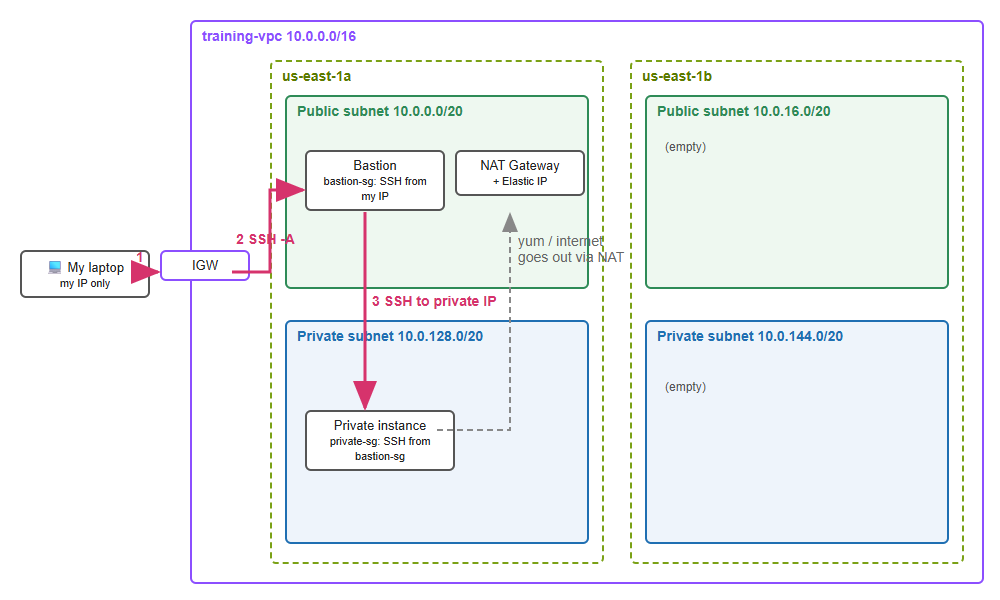

# Week 5 — Networking: VPC

This week I built my own VPC called `training-vpc` (10.0.0.0/16) with 2 AZs. Each AZ has 1 public subnet and 1 private subnet, and there is 1 NAT Gateway. Then I used a bastion host to reach an instance that has no public IP.

## How my traffic gets from my laptop to the private instance

1. **Laptop → Internet Gateway → bastion.** I SSH to the bastion's public IP with `ssh -A`. Traffic comes into the VPC through the Internet Gateway. The public route table sends it to the public subnet because it has a `0.0.0.0/0 → IGW` route. The bastion's security group only allows port 22 from my IP, so nobody else can connect.
2. **Bastion → private instance.** From inside the bastion I run `ssh ec2-user@10.0.131.12` (the private IP). This works because both subnets are in the same VPC, and every route table has a `local` route for 10.0.0.0/16. The private instance's security group allows SSH only from the bastion's security group, not from an IP.
3. **No key copied.** I used agent forwarding (`-A`), so my `.pem` stays on my laptop and the bastion just passes the login through. I checked and there were 0 key files on the bastion.

The private instance has no public IP, so the internet can't reach it directly. It can still go **out** to the internet: its route table sends `0.0.0.0/0` to the NAT Gateway in the public subnet. When I ran `curl checkip.amazonaws.com` on the private instance, it showed the NAT Gateway's Elastic IP, and `dnf` could reach the package repos.

## Things I learned

- A subnet is "public" only because its route table points to an Internet Gateway, not because of its name. That's why Debug Lab 5.3 says to check the subnet association, not just the routes.
- The NAT Gateway is not free (about $0.045/hour), so I deleted it as soon as I finished. I also released its Elastic IP, then deleted the instances and the VPC.
