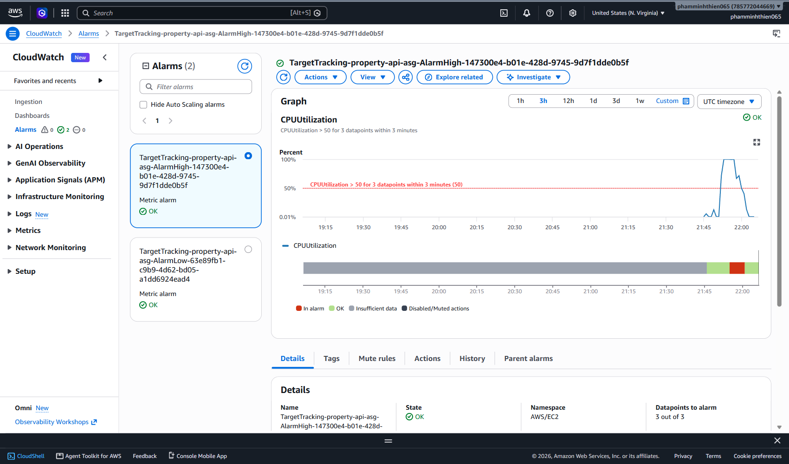
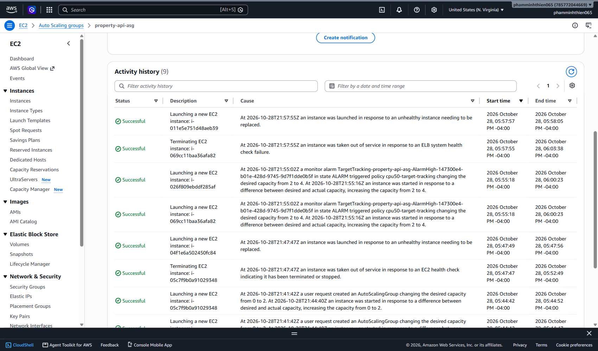

# Week 6 — Load Test Report

## Setup

- Rebuilt `training-vpc` from Week 5 (2 public + 2 private subnets, 1 NAT Gateway).
- Launch template `property-api-template`: Amazon Linux 2023, t3.micro, same PropertyLite user data as Week 3.
- Target group on port 8080 with health check `/health`, and an internet-facing ALB listening on HTTP:80 in both public subnets.
- ASG `property-api-asg` in the 2 private subnets, desired/min/max = 2/1/4, with a target tracking policy on average CPU = 50%.
- The instances' security group only allows 8080 from the ALB's security group. This avoids the 502 problem from Debug Lab 6.3.

`curl http://<alb-dns>/health` returned `{"status":"ok"}` and `/properties` returned the listings, so it's the same app as Week 3, now behind a load balancer with 2 instances.

## Self-healing test

I terminated one instance by hand at 17:47:08. The ASG noticed and launched a replacement at 17:47:49 (41 seconds later). The new instance was healthy in the target group about 4 minutes after that, once its user data finished.

## Scale-out test

I SSH'd into both instances through a bastion and ran a CPU stress test. The PDF uses `amazon-linux-extras` and `stress`, but those are for Amazon Linux 2. On Amazon Linux 2023 I used `stress-ng` instead:

```bash
sudo dnf install -y stress-ng
stress-ng --cpu 2 --timeout 600
```

I ran it on both instances because the policy looks at the **average** CPU of the group. With only one instance at 100%, the average would be about 50% and might not trigger.

### Timeline (EDT, Oct 28)

| Time | What happened |
|---|---|
| 17:51:36 | Started `stress-ng` on both instances |
| 17:52 | Average CPU jumped to 71%, then stayed at 100% |
| 17:55:02 | The target tracking alarm (CPU > 50 for 3 datapoints) went into ALARM, and the ASG changed desired capacity **from 2 to 4** |
| 17:55:18 | 2 new instances launched |

**Gap between the CPU spike and the scale-out: about 3 minutes** (17:52 → 17:55:02). That's because the alarm needs 3 datapoints in a row above 50% before it fires. I turned on detailed monitoring (1-minute metrics) in the launch template. With basic 5-minute metrics, it would have taken a lot longer.





## Something that went wrong

One of the 2 new instances got replaced again at 17:57:55 with "ELB system health check failure". I had set the health check grace period to 120 seconds, but the user data (`yum update` and installing Flask) takes longer than that. The ALB checked `/health` before the app was running, so the ASG replaced the instance. I raised the grace period to 300 seconds. So the grace period has to be longer than the time it takes the app to start.

## Cleanup

Deleted the ASG (which terminated its instances), then the ALB, the target group, the launch template, the bastion, and the whole VPC including the NAT Gateway and Elastic IP.
